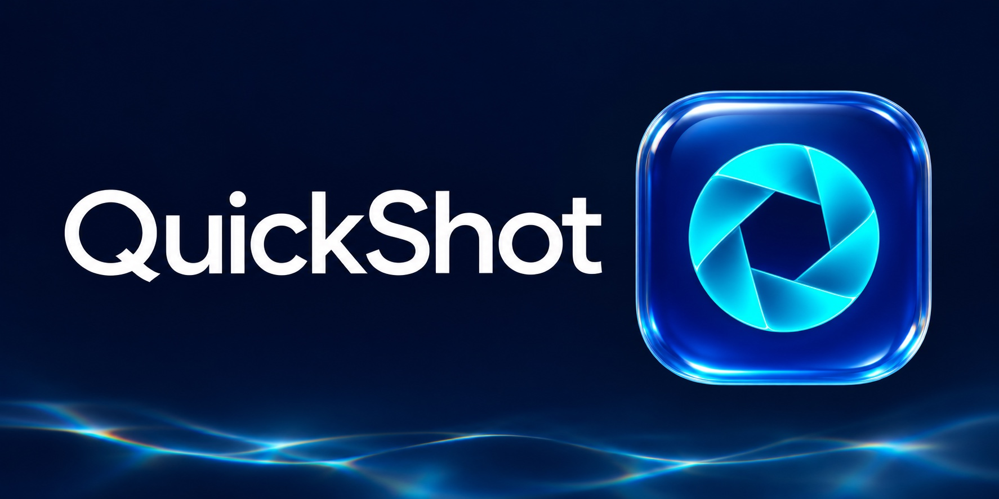

# QuickShot

Apple Silicon 版 macOS 菜单栏拍照工具，支持 macOS 13 及以上。macOS 26 使用原生液态玻璃拍照窗口。

[下载最新版本](https://github.com/andy1613785214/QuickShot/releases/latest) · [MIT 许可证](LICENSE)

下载 Release 中的 ZIP，解压后将 QuickShot.app 拖入「应用程序」并打开。首次启动后，可在菜单栏找到相机图标。公开构建使用临时签名，未经 Apple 公证。如系统拦截，确认来源后可在「系统设置 → 隐私与安全性」中允许打开，或按下方步骤从源码构建。

拍照窗口固定显示在鼠标所在屏幕的左上角，与可用区域边缘留出 12 点。窗口会避开菜单栏和 Dock，收到照片后自动收起。

| 操作 | 结果 |
| --- | --- |
| 按 ⌥S | 用 iPhone 拍照。点「使用照片」后，Mac 剪贴板中会出现可粘贴的 PNG 图片。 |
| 按住 ⌥，快速依次按 S、C | 用 iPhone 拍照。确认照片后 QuickShot 打开所选 ChatGPT 桌面应用，将图片粘入当前编辑框。问题和发送操作由你完成。 |
| 点菜单栏相机 | 可用鼠标发起上述操作，或切换登录启动。 |

按键间隔为 0.55 秒。多台设备可拍照时，从系统菜单选择一台。若 iPhone 未出现，请在两台设备上开启 Wi-Fi、蓝牙并登录同一个启用了双重认证的 Apple 账户。

同时安装 ChatGPT 和 ChatGPT Classic 时，可在相机菜单的「接收照片的应用」里切换。首次自动粘贴时，请在「系统设置 → 隐私与安全性 → 辅助功能」允许安装在「应用程序」中的 QuickShot。首次授权当次照片可直接用 ⌘V 粘贴。自动粘贴等待约 7.5 秒，期间可点入目标聊天的消息框。如果焦点或剪贴板发生变化，请按应用提示操作。

将应用放在「应用程序」中首次打开时会注册登录项。可从相机菜单关闭；若 macOS 要求批准，可在「系统设置 → 通用 → 登录项与扩展」管理。

## 构建

安装包含 macOS 26 SDK 的 Xcode 或命令行工具，运行 `./build.sh`。脚本默认生成同级的 QuickShot.app，以本机临时签名运行。可传入输出应用包路径。

相机接入使用 [Apple Continuity Camera](https://developer.apple.com/documentation/appkit/supporting-continuity-camera-in-your-mac-app)，系统负责发现设备和照片回传。QuickShot 在系统菜单仅有一个可识别的拍照命令时直接触发该命令。QuickShot 本身不保存照片文件。
